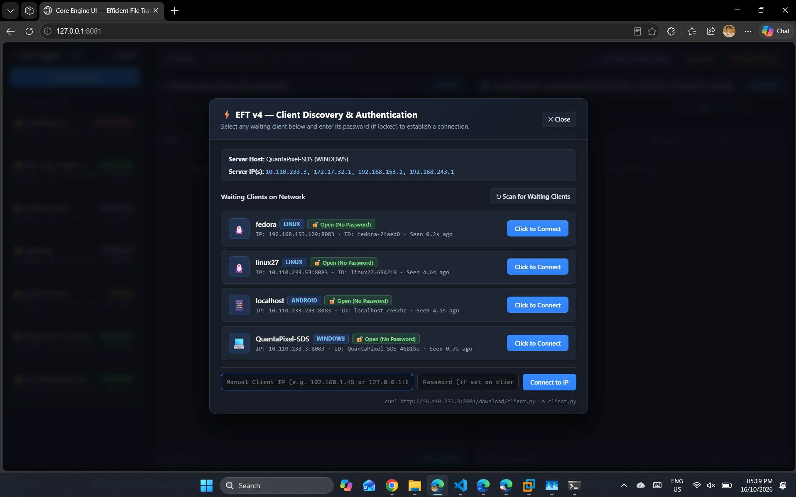
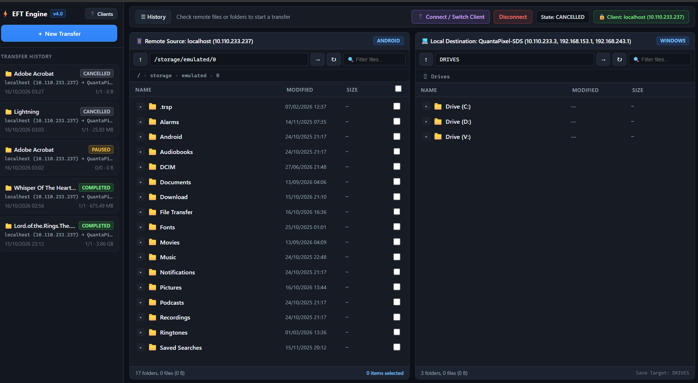
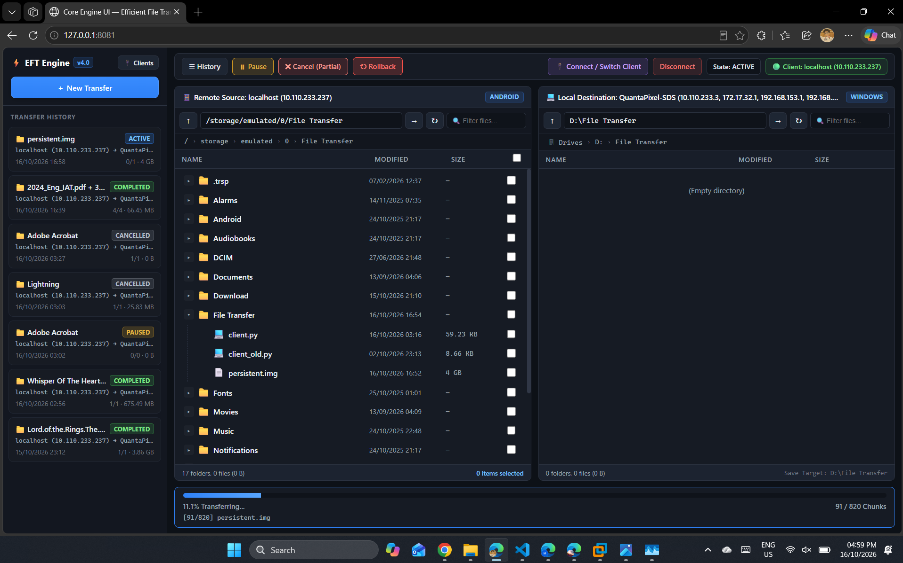
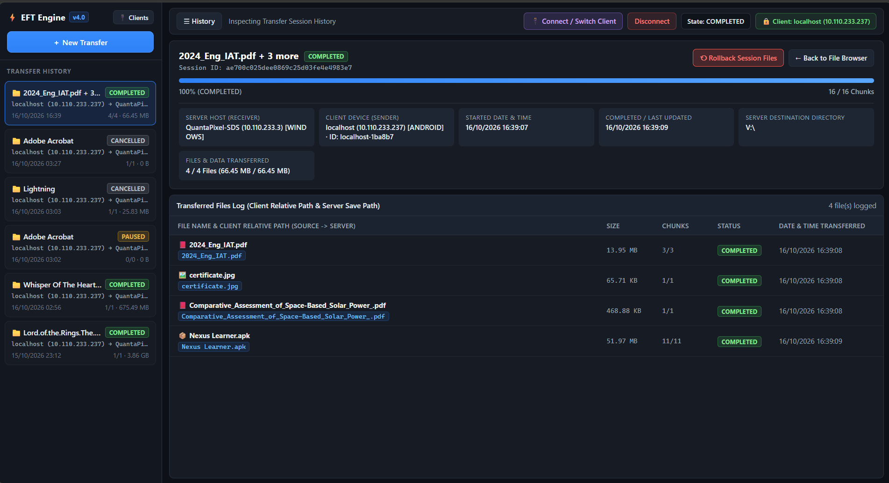
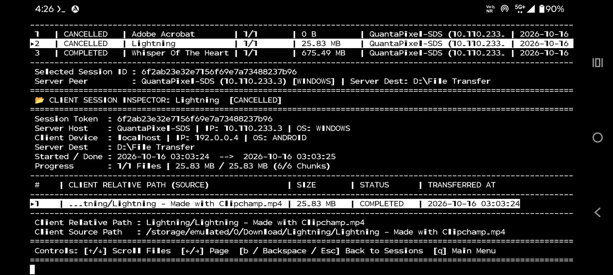
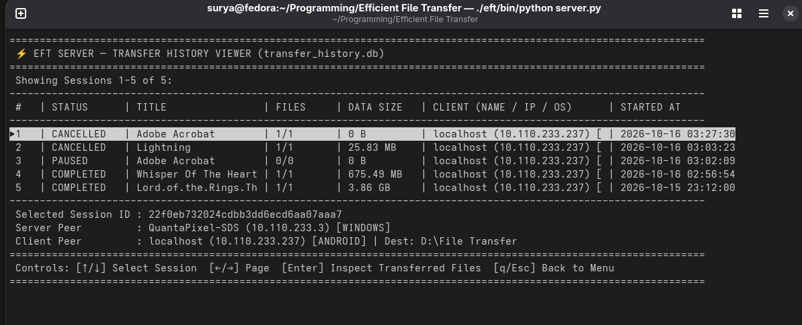
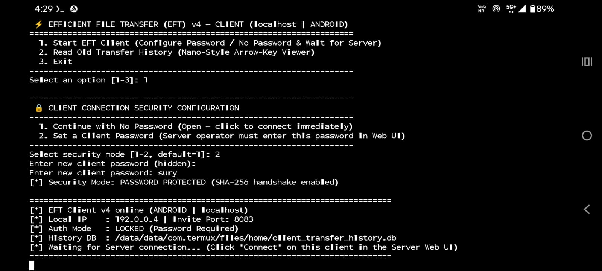

# 🛜 ⚡ Efficient File Transfer (EFT) — v4.0

[](https://opensource.org/licenses/Apache-2.0)
[](https://www.python.org/)
[](#)
[-2ea44f.svg)](#)
[](#)

**Efficient File Transfer (EFT)** (paired with its web interface **Core Engine UI**) is a high-throughput, multithreaded Wi-Fi/LAN file transfer engine built in Python. It is engineered from the ground up to bypass the severe protocol serialization and Queue Depth 1 (QD1) I/O bottlenecks of traditional USB Media Transfer Protocol (MTP), SMB, and standard OS file explorers.

By combining **5 MB direct-write disk pre-allocation**, a **bounded producer-consumer Zstandard compression pipeline**, **4x concurrent raw binary TCP socket streams**, and **transactional SQLite WAL state tracking**, EFT saturates local Wi-Fi and Ethernet links while keeping host NVMe/SSD utilization near idle.

---

## 📑 Table of Contents
1. [📊 Real-World Benchmark: Wi-Fi 6 EFT vs. USB MTP](#-1-real-world-benchmark-wi-fi-6-eft-vs-usb-mtp)
2. [✨ Key Features (v4.0)](#-2-key-features-v40)
3. [📸 Visual Tour & Interface Gallery](#-3-visual-tour--interface-gallery)
4. [🧠 Under the Hood: How EFT Works](#-4-under-the-hood-how-eft-works)
5. [🛜 Network Port Topology](#-5-network-port-topology)
6. [🚀 Step-by-Step Usage Guide (Server & Client)](#-6-step-by-step-usage-guide-server--client)
7. [🖥️ Interactive Terminal UI (TUI) & Nano-Style History Viewer](#️-7-interactive-terminal-ui-tui--nano-style-history-viewer)
8. [⚙️ Scalability & Configuration Tuning](#️-8-scalability--configuration-tuning)
9. [📂 Repository Structure](#-9-repository-structure)
10. [📜 License](#-10-license)

---

## 📊 1. Real-World Benchmark: Wi-Fi 6 EFT vs. USB MTP

Tested transferring a massive mixed directory (thousands of small source files, nested folders, documents, and large media payloads) from an Android device (running Termux) to a Windows PC over **Wi-Fi 6**:

| Benchmark Metric | Traditional USB MTP / Explorer | 🛜 ⚡ EFT Engine v4 (Wi-Fi 6) | Engineering Gain |
| :--- | :--- | :--- | :--- |
| **Workload Dataset** | 10,735 Files across 77 Folders (~1MB each) | 10,735 Files across 77 Folders (~1MB each) | **Identical Workload** |
| **Total Data Volume** | 4.60 GB (`4,947,399,050` bytes) | 4.60 GB (`4,947,399,050` bytes) | **100% Byte Parity** |
| **Total Elapsed Time** | ~8.5 Hours *(Projected)* | **2 Minutes 00 Seconds** | **~255x Faster** |
| **Sustained Throughput** | < 1.5 Mbps *(Stalls on small files)* | **363 Mbps (~45.4 MB/s)** | **Wire-Speed Saturation** |
| **Host NVMe Active Time** | 100% *(QD1 metadata lockup)* | **2% Disk Active Time** | **Zero Disk Thrashing** |

---

## ✨ 2. Key Features (v4.0)

* 🛜 **Zero-Config Wi-Fi / LAN Auto-Discovery:** Clients broadcast lightweight UDP presence beacons (`eft_client_beacon`) and respond to server probes (`eft_server_probe`). No hardcoded IP addresses required.
* 🔒 **Client-Controlled Password & SHA-256 Handshake:** Security is governed by the sender (`client.py`). At startup, the client operator chooses **No Password (Open)** or configures a **Client Password**. The Server Web UI displays `🔒 Password Protected` or `🔓 Open` badges and prompts for authentication before establishing a control channel.
* 🔄 **Multi-Peer Sequential Switching:** Connect to one client, transfer files, disconnect, and immediately connect to a different client (or switch servers from the client) with automatic state and directory tree cleanup.
* ⚡ **Direct-Write Pre-Allocation (Zero `.part` Files):** Pre-allocates target files on disk via `f.truncate(size)` and writes incoming 5 MB chunks directly to their calculated byte offsets (`chunk_index * CHUNK_SIZE`) using per-file thread locks—eliminating post-transfer file reassembly.
* 🗜️ **Adaptive Zstandard / zlib Compression:** Compresses chunks on the fly using `zstandard` (Level 3) with automatic zero-dependency fallback to Python's built-in `zlib` (Level 1) if `zstandard` is not installed.
* 🎛️ **Distinct Pause, Per-Session Resume, Cancel & Atomic Rollback:**
  * **Pause:** Halts workers while keeping partial files and chunk bitmaps intact.
  * **Resume:** Scoped strictly to incomplete/paused/interrupted sessions in History—transfers *only* missing chunks.
  * **Cancel:** Stops the transfer and deletes **only incomplete partial files** (and empty parent folders created for them), preserving 100% completed files.
  * **Rollback:** Atomically undoes an entire transfer session by deleting **all files and empty directories created in that session** (while protecting any pre-existing files where `pre_existed=1`).
* 🗄️ **Dual SQLite Databases & Automatic WAL Cleanup:** Tracks active chunk states in `transfer_state.db` and permanent audit logs in `transfer_history.db` (Server) + `client_transfer_history.db` (Client). Automatically checkpoints and switches from `WAL` to `DELETE` mode upon completion or exit so `.db-wal` and `.db-shm` files never linger.
* 🧭 **Modern Dual-Pane Web UI & Nano-Style CLI Viewer:** Browse remote and local filesystems with clickable breadcrumbs, live search filters, smart file-type icons, and inspect past transfers either in the Web UI or in a cross-platform arrow-key terminal UI (`nano`/`less` style).

---

## 📸 3. Visual Tour & Interface Gallery


### A. Zero-Config Client Discovery & Password Handshake
When the Web UI opens, it scans the LAN for waiting clients without ever auto-connecting. Locked clients require password verification before the control channel is established.



---

### B. Modern Dual-Pane File Explorer
Navigate both the **Remote Source Device** (`Android` / `Linux` / `Windows`) and **Local Destination Host** side-by-side with clickable path breadcrumbs, instant file filtering, and batch selection checkboxes.



---

### C. High-Speed Multithreaded Transfer in Action
Watch real-time chunk streaming progress across concurrent workers, with instant access to **Pause**, **Cancel (Partial)**, and **Rollback** controls.



---

### D. Session History Inspector & Per-File Audit Log
Every session logs full **Server Host** (`Name`, `IP`, `OS`) and **Client Device** (`Name`, `IP`, `OS`, `Client ID`) metadata, along with each file's client relative path (`relative_path`), client source path, server save path, chunk count, and completion timestamp.





---

### E. Interactive Terminal UI (TUI) & Nano-Style History Viewer
Both `server.py` and `client.py` include an interactive terminal startup menu and a keyboard-driven (`↑`/`↓`/`←`/`→`/`Enter`/`q`) history inspector for headless or terminal workflows.





---

## 🧠 4. Under the Hood: How EFT Works

```text
CLIENT (Sender: Android / Linux / Windows)                SERVER (Receiver: Windows / Linux / Android)
==========================================                ============================================
1. Scan selected paths -> Build POSIX Manifest  ───────►  2. Check transfer_state.db for existing chunks
   (Files + Empty Dirs + Sizes + Timestamps)              3. Pre-allocate missing files via f.truncate(size)
                                                ◄───────  4. Return delta missing_map (only missing chunks)
5. Producer Thread:
   - Seek & read 5 MB missing chunks
   - Compress via Zstd (L3) or zlib (L1)
   - Push to bounded Queue(maxsize=20)
         │
         ├──► Worker 1 (TCP :8080) [!II Frame]  ───────►  Decompress -> Lock(file_id) -> Seek & Write r+b
         ├──► Worker 2 (TCP :8080) [!II Frame]  ───────►  Decompress -> Lock(file_id) -> Seek & Write r+b
         ├──► Worker 3 (TCP :8080) [!II Frame]  ───────►  Decompress -> Lock(file_id) -> Seek & Write r+b
         └──► Worker 4 (TCP :8080) [!II Frame]  ───────►  Decompress -> Lock(file_id) -> Seek & Write r+b
                                                                │
6. Update client_transfer_history.db & print    ◄───────  7. On final chunk: os.utime(atime, mtime),
   live console log upon Server JSON ACK                     update transfer_history.db, checkpoint WAL
```

### Binary Wire Framing (`!II`)
Instead of slow text encoding, worker sockets stream raw binary packets prefixed with an 8-byte big-endian struct header:
```python
header = struct.pack('!II', len(meta_bytes), len(chunk_data))
worker_socket.sendall(header + meta_bytes + chunk_data)
```
* **Bytes `0..3` (`unsigned int`):** Exact byte length of the UTF-8 JSON metadata (`{"file_id": 12, "chunk_index": 0, "comp": "zstd"}`).
* **Bytes `4..7` (`unsigned int`):** Exact byte length of the compressed chunk payload.
* **Payload:** `meta_bytes` followed immediately by `chunk_data`.

---

## 🛜 5. Network Port Topology

Ensure these ports are allowed on your local Wi-Fi/LAN firewall:

| Port | Protocol | Bound By | Role & Description |
| :--- | :--- | :--- | :--- |
| **`8080`** | TCP | `server.py` | Core socket server for persistent JSON control channels (`control_auth`), manifest negotiation (`init_transfer`), and 4x binary chunk workers (`worker_auth`). |
| **`8081`** | HTTP / TCP | `server.py` | Flask Web UI server (`templates/index.html`), REST API endpoints, and `/download/client.py` distribution route. |
| **`8082`** | UDP | `server.py` | Server UDP discovery listener receiving `eft_client_beacon` broadcasts from waiting clients. |
| **`8083`** | TCP | `client.py` | Client TCP invite listener (with automatic `+15` port scan fallback) for instant Web UI click-to-connect handshakes. |
| **`8084`** | UDP | `client.py` | Client UDP probe listener for server broadcast scans (`eft_server_probe`) and UDP fallback invitations. |

---

## 🚀 6. Step-by-Step Usage Guide (Server & Client)

### Step 1: Install Dependencies
* **Python 3.8+** is required on both ends.
* **`server.py`** requires `flask` (and optionally `zstandard` for maximum speed).
* **`client.py`** runs out of the box using **only the Python Standard Library** (installing `zstandard` is optional and automatically detected).

```bash
# On the Server Host (Windows / Linux / macOS):
pip install flask zstandard

# On the Client Device (Optional — falls back to built-in zlib if omitted):
pip install zstandard
```

---

### Step 2: Start the Server (`server.py`)
On the computer where you want to host the Web UI and receive files:
```bash
python server.py
```
1. In the interactive terminal startup menu, press **`1`** (or hit `Enter`) to **Start EFT Server**. *(Tip: Pass `python server.py --no-menu` to skip the menu in automated setups).*
2. Open your browser to **`[http://127.0.0.1:8081](http://127.0.0.1:8081)`**.
3. Note the **Server Local IP** printed in the console (e.g., `192.168.1.10` or `10.110.233.3`).

---

### Step 3: Download & Start the Client (`client.py`)
On your source device (e.g., **Android Termux**, another Windows PC, or a Linux machine connected to the same Wi-Fi/LAN):

#### Option A: Fetch `client.py` Directly Over Wi-Fi via `curl` (No USB Cable Needed!)
```bash
# If using Android Termux for the first time, grant storage access once:
termux-setup-storage

# Download client.py directly from the running Server:
curl http://<SERVER_LAN_IP>:8081/download/client.py -o client.py

# Run the client:
python client.py
```

#### Option B: Run Local `client.py` Directly
```bash
python client.py
```

1. In the client terminal menu, select **`1`** (`Start EFT Client`).
2. **Configure Security Mode:**
   * Press **`1`** (or `Enter`) for **No Password (Open)** — allows immediate one-click connection from the Server Web UI.
   * Press **`2`** to **Set a Client Password** — requires the Server Web UI operator to enter your password before connecting.

---

### Step 4: Connect & Transfer Files via the Web UI
1. In the Server Web UI (`[http://127.0.0.1:8081](http://127.0.0.1:8081)`), the **Client Discovery & Authentication** modal will display your waiting client automatically (or click **↻ Scan for Waiting Clients**).
2. Click **Click to Connect** (or **🔑 Enter Password & Connect** if you locked the client).
3. **Select Destination (Right Pane):** Navigate to the folder on your Server where files should be saved. Using the address bar, breadcrumbs, or expanding folders automatically sets the active `Save Target`.
4. **Select Source Items (Left Pane):** Browse your remote client's files/folders, check the items you want to transfer, and click **🚀 Copy (N) Items**.
5. **Watch Live Progress:** Both the Web UI progress bar and the Client terminal will display real-time transfer progress:
   ```text
   [2026-10-16 03:14:22] ✓ Transferred DCIM/Camera/VID_01.mp4 (124.50 MB) [12/45 files | 64.2%] -> Server QuantaPixel-SDS (10.110.233.3)
   ```

---

## 🖥️ 7. Interactive Terminal UI (TUI) & Nano-Style History Viewer

Both `server.py` and `client.py` feature a built-in terminal interface that works cross-platform on Windows (`msvcrt`) and Linux / Android Termux (`termios` + `tty`):

```text
====================================================================
 ⚡ EFFICIENT FILE TRANSFER (EFT) v4 — CLIENT (localhost | ANDROID)
====================================================================
  1. Start EFT Client (Configure Password / No Password & Wait for Server)
  2. Read Old Transfer History (Nano-Style Arrow-Key Viewer)
  3. Exit
--------------------------------------------------------------------
Select an option [1-3]:
```

When you select **`2. Read Old Transfer History`**, EFT launches a full-terminal interactive table:
* **`↑` / `↓` Arrow Keys:** Move selection highlight across past transfer sessions or individual transferred files.
* **`←` / `→` or `PgUp` / `PgDn`:** Jump across pages of sessions or files.
* **`Enter`:** Open the **Session Inspector** for the highlighted session to view every file's `relative_path`, `source_path` / `save_path`, size, status, and timestamp.
* **`b` / `Backspace` / `Esc`:** Return from the File Inspector back to the Sessions list.
* **`q`:** Exit the history viewer and return to the main startup menu.

---

## ⚙️ 8. Scalability & Configuration Tuning

Enthusiast developers can tune EFT's concurrency and chunking parameters at the top of `server.py` and `client.py` to match specific hardware profiles:

| Constant / Parameter | Default Value | Tuning Recommendation |
| :--- | :--- | :--- |
| `CHUNK_SIZE` | `5 * 1024 * 1024` (5 MB) | **Wi-Fi 5/6:** Keep at `5 MB`. **2.5GbE / 10GbE LAN:** Increase to `16 * 1024 * 1024` (16 MB). **Slow/Congested Wi-Fi:** Lower to `2 * 1024 * 1024` (2 MB). *(Must match on Server & Client).* |
| `work_queue` (`maxsize`) | `20` chunks (~100 MB cap) | Controls the bounded memory buffer in `client.py` (`queue.Queue(maxsize=20)`). Increase to `40` on high-RAM desktops; lower to `8` on low-memory IoT boards. |
| Worker Thread Count | `4` concurrent sockets | Configured in `execute_transfer()` and `process_and_compress_chunks()`. Scale to `6` or `8` threads to saturate multi-gigabit links. |
| Compression Level | `zstd` Level `3` / `zlib` Level `1` | Configured in `process_and_compress_chunks()`. Increase `zstd` to Level `6` for text/code datasets over slower Wi-Fi, or Level `1` when CPU-bound on older mobile SoCs. |

---

## 📂 9. Repository Structure

```text
EFT-File-Transfer-WiFi-Multi-threaded/
├── server.py                  # Host TCP/UDP Engine, Dual-SQLite WAL Manager, TUI Viewer & Flask API
├── client.py                  # Producer-Consumer Chunk Streamer, Beacon Engine, Client DB & TUI Viewer
├── templates/
│   └── index.html             # Modern Dual-Pane Web UI, Breadcrumb Explorer & Session Inspector
├── assets/
│   └── screenshots/           # UI & Terminal screenshots for documentation
├── LICENSE                    # Apache License 2.0
└── README.md                  # Architecture, Benchmark & Usage Documentation
```

---

## 📜 10. License

Copyright © 2026 Surya Pratap Singh.

Licensed under the **Apache License, Version 2.0** (the "License"); you may not use this project except in compliance with the License. You may obtain a copy of the License at:

[http://www.apache.org/licenses/LICENSE-2.0](http://www.apache.org/licenses/LICENSE-2.0)

Unless required by applicable law or agreed to in writing, software distributed under the License is distributed on an "AS IS" BASIS, WITHOUT WARRANTIES OR CONDITIONS OF ANY KIND, either express or implied. See the License for the specific language governing permissions and limitations under the License.
